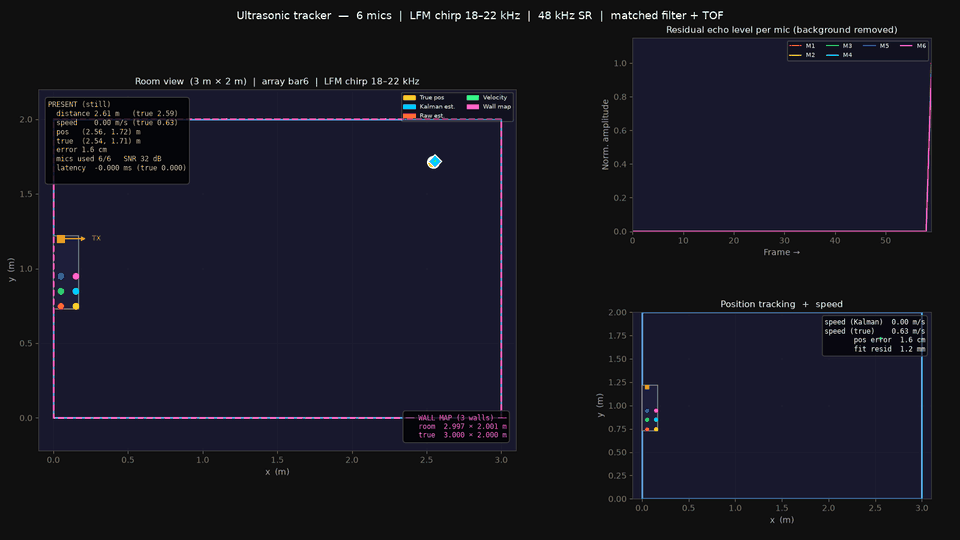

# ultra_track_and_map

Ultrasonic tracking and room mapping with a 6‑mic array on a 50 × 10 cm bar
mounted on a wall. A speaker on the bar sends short chirps; the mics pick up the
echoes. From those echoes the system:

- **tracks a moving object** (position + velocity), and
- **maps the room**: finds the fixed walls and estimates the room size.

The code is currently a **simulator with a live visualizer**: it simulates the
room acoustics and runs the full signal-processing pipeline on the simulated
microphone signals.



*Left: top view of the 3 × 2 m room with the mic bar and speaker (TX) on the
left wall. Yellow = true object position, cyan ◆ = Kalman estimate, orange × =
raw single-ping fix, green arrow = estimated velocity, dashed pink = room
outline estimated by wall mapping. Right: per-mic echo envelopes and the
tracked trajectory with speed readout. 10 s, real time, after the 2 s
background calibration.*

To regenerate the GIF: `python tools/make_gif.py` (writes `docs/simulation.gif`).

## Quick start

```sh
./setupenv.sh                         # creates .venv with numpy, scipy, matplotlib
source .venv/bin/activate
python simulator.py                   # live visualizer
python simulator.py --eval 300        # headless accuracy report (tracking + wall map)
```

Options:

| Option | Meaning |
|---|---|
| `--eval N` | run N frames without a window and print accuracy statistics |
| `--seed S` | random seed |
| `--fs HZ` | sample rate (default 48000) |
| `--band F0 F1` | chirp band in Hz (default 18000–22000) |
| `--room W D` | simulated room size in metres (default 3 × 2) |
| `--object-multipath` | **experimental**: also simulate object↔wall bounces (see limitations) |

## How it works

**Signal:** 5 ms LFM chirp 18–22 kHz, Tukey‑tapered on transmit (low range
sidelobes), matched filter with a Hann‑weighted reference, 48 kHz sample rate.

**Static background:** the first 20 pings (2 s) give a median background; after
that it is updated slowly, skipping the tracked object and pausing while the
track is lost. It is subtracted before tracking, which removes the wall echoes.

**Tracking** (`simulator.py`)
1. Per mic: time of flight TX → object → mic from the matched-filter envelope
   peak, searched around the Kalman prediction.
2. Position = least-squares intersection of the six range ellipses.
3. Constant-velocity Kalman filter with outlier gating and re-acquisition.
   The chirp's range–Doppler coupling (≈ 25 mm per m/s) is part of the
   measurement model.

**Wall mapping** (`wallmap.py`, independent of the simulator)
1. Each wall echoes like a mirror image of the speaker. Search over wall
   angle and distance for the echo seen consistently by all mics.
2. Fit that wall's echo — including its "twin" via the mounting wall right
   behind the array — subtract it, and repeat (CLEAN).
3. Reject corner/double-bounce echoes and walls lying outside the room
   formed by the others; intersect the walls into the room outline.
4. Optional rectangular-room prior (default on) snaps angles within 8° of a
   right angle.

## Simulated accuracy

`--eval`, 48 kHz, no object multipath:

| Room | Tracking (mean) | Room size estimate |
|---|---|---|
| 3 × 2 m | 0.5 cm | 2.997 × 2.000 m |
| 4.5 × 3.2 m | 2 cm | 4.500 × 3.201 m |
| 6 × 4 m | 5–7 cm | 6.000 × 4.002 m |
| 2.5 × 2.5 m | 0.5 cm | 2.499 × 2.501 m |

## Limitations

- **Object↔wall multipath is not handled robustly.** With `--object-multipath`
  tracking loses lock near walls and corners (mean error ~50 cm). A
  multipath-aware fit using the wall map and a global re-acquisition search are
  included but are experimental.
- Without the rectangular prior, wall angles are only good to about 1–3°,
  which can put the room size off by up to ~20 cm.
- The mounting wall is assumed known; walls closer than ~45 cm to the speaker
  are not detected.
- The simulation is 2D (no floor/ceiling) and still idealised.

## Hardware notes

- At 48 kHz many audio codecs filter above ~21.5 kHz; a 17–21 kHz band
  (`--band 17000 21000`) tracks just as well in simulation.
- All six mics and the speaker should share one sample clock (one multichannel
  interface), and the exact sample at which each chirp is sent must be known.
- Taper the transmitted chirp the same way as the simulator does.

`detector.py` and `transmitter.py` are earlier hardware scripts (Raspberry Pi
`pigpio` square-wave transmitter, `sounddevice` capture with a CW/bandpass
approach); they do not yet implement the chirp pipeline above.
