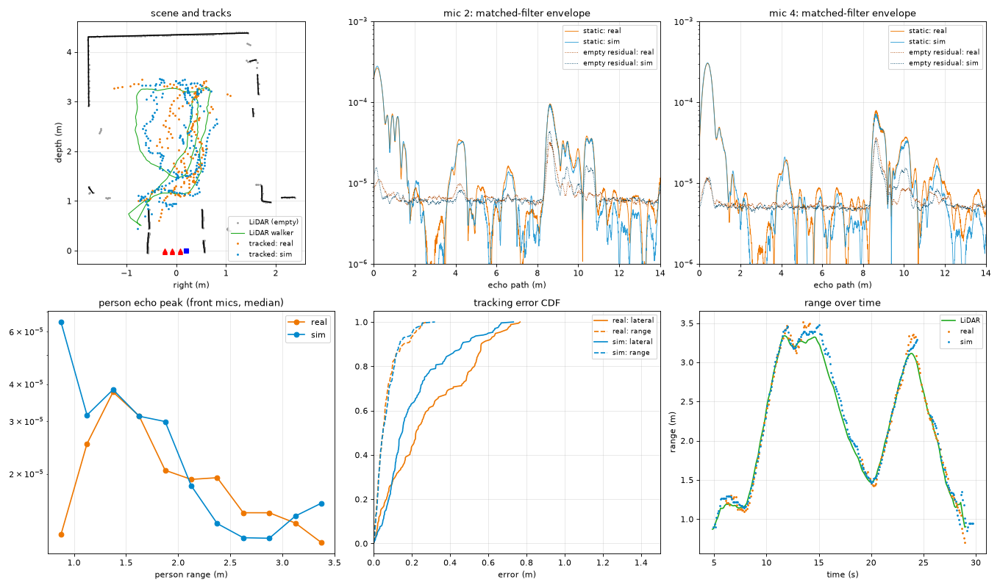

# ultra_track_and_map

Ultrasonic presence detection, tracking and room mapping with a small mic
array and one speaker. The speaker sends short chirps; the mics pick up the
echoes. From those echoes the system:

- **detects** when something is in the room that wasn't there during
  calibration, and how far away it is (also when it stands still),
- **tracks** it (position + velocity), and
- **maps the room**: finds the walls and estimates the room size.

The mic layout and where it sits in the room are just data. Built-in layouts
include the original 6‑mic 50 × 10 cm bar, a 4‑mic line, a 3‑mic triangle and
an 8‑mic ring, or you can use your own. The array can be wall‑mounted on any
wall or free‑standing at any angle.

The code is currently a **simulator with a live visualizer**: it simulates the
room acoustics and runs the signal-processing pipeline (`tracker.py`,
`wallmap.py`; the same code you would run on hardware) on the simulated
microphone signals. The same pipeline also runs live on an Audiodevice target
(see [Audiodevice live demo](#audiodevice-live-demo)).


*Left: top view of the 3 × 2 m room with the mic bar and speaker (TX) on the
left wall. Yellow = true object position, cyan ◆ = Kalman estimate, orange × =
raw single-ping fix, green arrow = estimated velocity, dashed pink = room
outline estimated by wall mapping. Right: per-mic residual echo level and the
tracked trajectory with speed readout. 10 s, real time, after the 2 s
background calibration.*

To regenerate the GIF: `python tools/make_gif.py` (writes `docs/simulation.gif`).

## Quick start

```sh
./setupenv.sh                         # creates .venv with numpy, scipy, matplotlib
source .venv/bin/activate
python simulator.py                   # live visualizer
python simulator.py --eval 300        # headless accuracy report (tracking + wall map)
python simulator.py --array ring8 --pose 1.2 1.6 -60 --room 4 3   # other array + placement
python simulator.py --latency 23.7 --jitter 5 --eval 300          # unknown audio latency
```

Options:

| Option | Meaning |
|---|---|
| `--array NAME\|FILE` | mic layout: `bar6` (default), `line4`, `tri3`, `ring8`, or a JSON file |
| `--pose X Y DEG` | array mounting point in the room (m) and facing direction (0° = +x). Default: middle of the left wall, facing into the room |
| `--speaker auto\|cardioid\|omni` | speaker directivity (auto: cardioid when wall-mounted, else omni) |
| `--room W D` | simulated room size in metres (default 3 × 2) |
| `--latency MS` | simulated playback→recording latency (default 0) |
| `--jitter MS` | extra random latency per ping, 0…MS (default 0) |
| `--no-sync` | don't measure the latency (sample 0 must be the transmit instant) |
| `--eval N` | run N frames without a window and print accuracy statistics |
| `--seed S` | random seed |
| `--fs HZ` | sample rate (default 48000) |
| `--band F0 F1` | chirp band in Hz (default 18000–22000) |
| `--object-multipath` | **experimental**: also simulate object↔wall bounces (see limitations) |

**Custom arrays.** Give the layout in the array's own frame: x = forward (the
way the speaker faces, away from the wall), y = to the left, origin = the
mounting point. Units are metres.

```json
{"mics": [[0.05, -0.20], [0.05, 0.0], [0.05, 0.20], [0.15, 0.0]], "tx": [0.05, 0.10]}
```

Use at least 3 mics. If all mics and the speaker lie on one line, the array
can't tell front from back unless it is wall-mounted (the tracker warns about
this).

**Wall-mounted or free-standing.** If the pose puts the mounting point on a
wall and the array faces straight into the room, that wall becomes the known
*mounting wall*. Everything else counts as free-standing.

## How it works

**Signal:** 5 ms LFM chirp 18–22 kHz, Tukey‑tapered on transmit (low range
sidelobes), matched filter with a Hann‑weighted reference, 48 kHz sample rate.
The analytic (envelope) signal is formed in the frequency domain on the
zero-padded record, so the loud direct sound can't wrap around onto the end of
the record.

**Speaker/mic sync:** audio hardware starts playback and recording with an
unknown delay, and it may vary from ping to ping. Each ping's recording only
has to start *before* the chirp is heard (up to `max_latency_s`, default
50 ms, earlier). The tracker measures the latency from the direct
speaker→mic sound, whose delay is known from the geometry:
1. Find the earliest strong arrival that lines up across all mics with the
   known speaker→mic distances. Once calibrated, the threshold comes from the
   direct sound's own level, so a loud echo from an object close to the
   array right after it doesn't win.
2. Refine by fitting the exact pulse shape at the direct delay and at the
   mounting-wall reflection delay. That reflection overlaps the direct sound
   and would otherwise bias the estimate by ~2–3 samples.
3. Shift the recording (fractionally, in the frequency domain) so that
   sample 0 is the moment the chirp left the speaker. This also cancels any
   fixed speaker/ADC delay.
4. Lock it to the background using the carrier phase of the direct sound,
   to ~1/50 of a sample, so the background subtracts coherently. If the
   direct sound doesn't match the background's (an object right at the
   array), the last good latency is used instead, and that ping is not
   learned into the background.

**Static background:** the first 20 pings (2 s) give a median background.
After that it is updated slowly, skipping the tracked object, and fully
whenever nothing is detected. It is subtracted before detection, which removes
the wall echoes.

**Detection + tracking** (`tracker.py`, independent of the simulator)
1. Detection: per mic, compare the strongest residual echo with that mic's
   noise level. "Detected" means at least half the mics (and at least 3) see
   an echo 21 dB above noise. A person who stops stays detected, because the
   background doesn't absorb them.
2. Acquisition (new or lost track): grid search for the point whose echo
   delays line up across all mics.
3. Per mic: time of flight TX → object → mic, searched around the Kalman
   prediction. Mics with a weak echo are left out.
4. Position from a robust (soft‑L1) least-squares fit of the range ellipses,
   so one mic with a wrong peak doesn't drag the fix. The fix is kept in
   front of the mounting wall.
5. Constant-velocity Kalman filter with outlier gating and re-acquisition.
   The chirp's range–Doppler coupling (≈ 25 mm per m/s) is part of the
   measurement model. The filter weights each axis by what the array geometry
   can resolve.

The wall map is only drawn on screen. It never limits tracking, so a wrong map
can't hurt the track.

**Wall mapping** (`wallmap.py`, independent of the simulator) runs after
calibration and then every 50 pings. With `Tracker(async_map=True)`, as in
the live visualizer, it runs in a separate process (about 1 s of work), so
it never stalls the pings or the animation.

1. Each wall echoes like a mirror image of the speaker. A grid search over
   wall angle and distance looks for echoes seen consistently by all mics.
2. For the best grid peak in each 30° sector of wall angle, the wall's echo is
   fitted with the exact pulse shape, including its "twin" via the mounting
   wall. The candidate that explains the most echo energy wins: with a small
   array the envelopes alone can't tell a wall ahead from a side wall at a
   wrong angle. The fitted echo is subtracted, and the process repeats (CLEAN).
3. Rectangular-room prior (default on): a wall is snapped to the nearest right
   angle (relative to the mounting wall, or to the first wall found if
   free-standing) if the snapped wall still explains ≥ 80 % of the echo
   energy. Small arrays snap readily; large ones can still report a slanted
   wall.
4. Reject corner/double-bounce echoes and walls lying outside the room formed
   by the others, then intersect the walls into the room outline.

**Performance:** simulation + tracking take ~11 ms per ping. The live view
redraws only the parts that change (blitting), ~55–60 ms per frame, so it
keeps up with the 10 pings/s rate.

## Using it on hardware

`tracker.py` and `wallmap.py` don't depend on the simulator. Work in the
array's own frame, where the mounting wall is the line x = 0:

```python
import numpy as np, arrays, tracker, wallmap

layout = arrays.load("bar6")                       # or your JSON file
chirp  = tracker.Chirp(fs=48_000, f0=18_000, f1=22_000)
trk    = tracker.Tracker(layout["mics"], layout["tx"], chirp, n_samples=1800,
                         mount_wall=wallmap.Wall(np.array([1.0, 0.0]), 0.0),  # None if free-standing
                         max_latency_s=0.05)
# every 100 ms: play chirp.burst and record (n_samples + 0.05·fs) × n_mics,
# starting the recording no later than the playback (latency is measured)
out = trk.process(recording)
if not out["calibrating"] and out["detected"]:
    print(out["range_m"], out["pos"], out["vel"], out["latency_ms"])
```

## Simulated accuracy

`--eval 200 --seed 0`, 48 kHz, sync on, no object multipath. Tracking is the
mean Kalman position error over all pings (every ping is detected unless
noted). Distance is accurate to ~1 mm.

| Array, placement | Room | Tracking | Room size estimate |
|---|---|---|---|
| bar6, left wall | 3 × 2 m | 0.6 cm | 2.997 × 2.000 m |
| bar6, left wall | 4.5 × 3.2 m | 1.8 cm | 4.500 × 3.200 m |
| bar6, left wall | 6 × 4 m | 4.8 cm | 6.000 × 4.000 m |
| bar6, left wall | 2.5 × 2.5 m | 0.4 cm | 2.499 × 2.501 m |
| bar6, right wall | 3 × 2 m | 0.4 cm | 2.997 × 2.000 m |
| line4, left wall | 3 × 2 m | 0.3 cm | 2.986 × 1.998 m |
| ring8 / tri3, wall-mounted | 3 × 2 m | 0.8–0.9 cm | not closed (side wall missed) |
| ring8, free, (0.6, 0.4) at 30° | 3 × 2 m | 0.6 cm | 3.24 × 2.34 m |
| tri3, free, (1.2, 1.6) at −60° | 3 × 2 m | 0.8 cm | 3.22 × 2.24 m |
| bar6, free, (1, 1) at 20° ¹ | 3 × 2 m | 2.7 cm, 5 pings missed | wrong |

¹ The simulated path passes over this array (within 1 cm of a mic).

**Latency sync** (`--latency 23.7 --jitter 5`): the latency error is
0.1–1 µs mean, ≤ 5 µs max (1 sample = 20.8 µs), and tracking is unchanged
(bar6 0.5 cm, ring8 0.6 cm, 6 × 4 m room 3.5 cm). Without sync, 23.7 ms of
latency puts fixes ~4 m off, and even 0.1 ms of jitter gives ~2 m errors.

**Detection:** 0 false detections in an empty room (the worst noise peak is
≈ 14 dB vs. the 21.6 dB threshold for starting a track). A stopped object
stays detected; a weak, distant one stays tracked through its gate.

## Limitations

- **Wall mapping needs aperture.** Tracking works with any layout, but the
  wall *angles* come from the small delay differences across the array. With
  a compact array (ring8 ≈ 10 cm, tri3 ≈ 15 cm) or a free-standing one, the
  map is often off. This is worst when two walls are at the same distance on
  either side, which makes their echoes overlap at every mic. The map is only
  drawn on screen, so this doesn't affect tracking. A joint fit of all walls
  (instead of one at a time) would be the next step.
- **Object↔wall multipath is not handled robustly.** With `--object-multipath`
  tracking loses lock near walls and corners (mean error ~50 cm). A
  multipath-aware fit using the wall map is included but is experimental; in
  this mode the wall map is also used to bound the search.
- A free-standing array whose mics and speaker are on one line can't tell
  front from back.
- **Sync with an object right at the array.** When an object is within
  ~40 cm of the array, its echo overlaps the direct sound and that ping can't
  be synced on its own; the last good latency is reused. That is exact with
  constant latency (one full-duplex audio stream, which you need anyway for a
  shared sample clock). With jittering latency (separate play/record calls
  per ping) such pings are wrong. The sync also assumes all mic channels
  share one sample clock and start together.
- Walls closer than ~45 cm to the speaker are not detected.
- The simulation is 2D (no floor/ceiling) and still idealised; the simulated
  object path is fixed, so for some placements it passes close to the array.

## Hardware notes

- At 48 kHz many audio codecs filter above ~21.5 kHz; a 17–21 kHz band
  (`--band 17000 21000`) tracks just as well in simulation.
- All mics and the speaker should share one sample clock (one multichannel
  interface). The exact sample at which each chirp is sent does *not* need
  to be known: the tracker measures it from the direct sound (see
  "Speaker/mic sync"). Start each recording no later than the playback.
- Taper the transmitted chirp the same way as the simulator does.

`detector.py` and `transmitter.py` are earlier hardware scripts (Raspberry Pi
`pigpio` square-wave transmitter, `sounddevice` capture with a CW/bandpass
approach); they do not yet implement the chirp pipeline above.

## Audiodevice capture experiment

`audiodevice_capture.py` records the target's six raw microphones while playing a
two-second chirp train. It is a hardware probe, **not yet a live tracker**:
chirp timing, physical microphone/speaker geometry, off-axis detection and
the simulator's tracking pipeline still need hardware calibration.

The Audiodevice geometry supplied for the test below differs from the simulator.
Coordinates are in centimetres relative to the speaker, with positive
along-bar coordinates to the right as viewed from the front and negative
depth behind the speaker. Channel numbers are zero-based:

| Channel | Along bar | Depth |
|---|---:|---:|
| 0 | 27 | 0 |
| 1 | 27 | -3.5 |
| 2 | 11 | 0 |
| 3 | 11 | -3.5 |
| 4 | 43 | 0 |
| 5 | 43 | -3.5 |

The device center is 19 cm to the right of the speaker. These supplied
coordinates have not yet been validated by a position-tracking test.

**Correction (checked against walk1 and confirmed on the hardware).** Looking
into the room from behind the device, the speaker is at the *right* end of the
bar. From the speaker the order along the bar is mic 2 (11 cm), mic 4 (27 cm),
then mic 0 (43 cm). The table above is mirrored (it was written as seen from the
front) and has channels 0 and 4 swapped. `audiodevice_tracking.py` uses the
corrected layout. The rear mics are assumed to sit behind 0, 2 and 4 as listed;
that pairing is not verified.

From this directory, with this checkout inside `platform_dsp_qcs`:

```sh
adb devices -l
adb -s SERIAL root
.venv/bin/python audiodevice_capture.py --serial SERIAL --band 18000 22000 /tmp/audiodevice.wav
.venv/bin/python audiodevice_capture.py --serial SERIAL --band 18000 22000 --level 20 /tmp/audiodevice-20.wav
adb -s SERIAL unroot
```

The device must have its speaker route active and its microphone capture route
idle; do not run it during a call or other audio use. The tool temporarily
configures the microphones using a compatible six-channel PCM profile from the
parent platform project, then restores the previous mixer values. A forced termination or device
disconnect can prevent restoration.

The chirp starts no lower than 10 kHz and uses 5 ms pulses at 10 Hz. Playback
defaults to 1% peak amplitude; `--level 20` requests 20% peak amplitude, and
the tool refuses values above 20%. Digital level is **not** a sound-pressure
measurement. High frequencies may be inaudible, so lack of discomfort does not
establish safety. Keep people and animals clear unless the acoustic output has
been measured safe. The optional `--band 12000 16000` showed stronger
responses on this device, but is within the audible range. The WAV contains raw
microphone audio, including any speech in the room. The recording does not
provide a synchronized transmit sample or calibrated positions.

## Audiodevice live demo

The Python GUI streams all six microphones over ADB, synchronizes to the chirps,
and shows background-subtracted changes and experimental candidate positions.
It runs `AudiodeviceMapper` (through `audiodevice_mapper.LiveMapper`), the
same tracker `audiodevice_recording.py replay` scores, on the 3 front mics. Its
range and angle were calibrated against a LiDAR on one recording (walk1:
lateral error median 0.22 m, p90 0.56 m). Accuracy elsewhere is unvalidated.
The trace panel shows each front mic's echo (change from the background) by
echo path from the speaker. The map shows the mapper's change evidence out to
4 m, with the facing wall as a dashed line. The wall's depth comes from the
background's strongest echo; it is the one wall the 3-mic line can place
reliably. Walls, chairs and other static objects are otherwise subtracted as
background, which is why the map shows only what moves.

Use the same device, routing and safety prerequisites as the capture
experiment above. From this directory, after running `./setupenv.sh`:

```sh
adb devices -l
adb -s SERIAL root
.venv/bin/python audiodevice_live.py --serial SERIAL --band 18000 22000 --level 20
```

Replace `SERIAL` with the device's ADB serial, or omit `--serial` to detect a
single connected ADB device. The example uses 20% digital peak because a 1%
device test did not synchronize, while one 20% test synchronized and completed
calibration. **Neither result establishes a safe acoustic level.** The GUI
defaults to 1%; `--level` accepts values above zero through 20%. By default a
session plays chirps continuously until **Stop** is pressed or the window is
closed (a single playback stream ends by itself after about 3.1 hours, the
32-bit WAV size limit). `--seconds N` optionally ends the session after N
seconds (minimum 5). Chirps begin at 10 kHz or above and end below 24 kHz; the
default is 18–22 kHz.

Opening the window does not play audio. Press **Start** to begin the
session. Leave the target out and the background still during synchronization
and calibration; then look for changes on the map. **Recalibrate** records a
new stationary background; **Stop** ends playback and restores the mixer.
Traces are normalized per microphone and the heat map is change evidence,
not a room map. Candidates appear on the first update that passes the signal
threshold and has support from at least three microphones, without waiting for
a second consistent estimate. Each update averages the latest five pings
(0.5 seconds) but a new update is produced after every ping, so the display
refreshes 10 times per second; consecutive updates share four of their five
pings, so motion still appears smoothed over about half a second. Initial or
inconsistent estimates appear in orange as unconfirmed candidates; the marker
turns cyan when the estimate agrees with the one from 0.5 seconds earlier,
which shares no pings with it. Synchronization and calibration likewise use
non-overlapping pings and take as long as before. Showing unconfirmed
candidates can expose transient false positives and position jumps; a candidate
is not guaranteed to be a real target.

Playback and microphone audio pass through FIFOs in `/data/local/tmp`, so raw
microphone audio is not accumulated on the device during long sessions. The
FIFOs and small chirp files are removed on normal stop or exit, but a forced
termination or disconnect can leave them or the mixer settings behind. If the
device starts using its microphones (for example, a call or USB audio from the
host), the device's audio stack takes over the microphone route and the session
ends with an error; the GUI refuses to start while that route is in use. The tool leaves ADB rooted for repeated tests. If desired, run
`adb -s SERIAL unroot` after closing the window.

### Browser streaming server

`audiodevice_server.py` runs the same device session and tracker as a local
streaming server and draws the results in a web browser. Redrawing in the
browser takes a few milliseconds per update, against about 0.2 seconds for the
Matplotlib window, so use the server when the GUI feels slow:

```sh
.venv/bin/python audiodevice_server.py --serial SERIAL --band 18000 22000 --level 20
```

Open the printed address (default `http://localhost:8765/`; with VS Code
Remote, forward the port) and press **Start**, **Recalibrate** or **Stop**. It
accepts the same `--band`, `--level` and `--seconds` options as the GUI, plus
`--port`. Unlike the GUI, the server defaults to `--level 20`. Opening the page does not play audio. Only one device session runs at
a time; every open page shows the same live stream. Updates are sent with
Server-Sent Events at the tracker's rate of 10 per second, and a slow page
skips stale updates rather than delaying the stream.

The server listens on `127.0.0.1` only. Control requests must carry a custom
header and a local `Host`, so other web pages cannot start playback. `--host`
can expose the server on a network, but then anyone who can reach it can start
the device's audio. Press Ctrl+C (or send SIGTERM) to stop the server; it ends
any session and restores the device first.

Both the GUI and the server batch the mixer reads and writes for the
microphone route into single ADB calls, so opening and restoring the route
takes about 2 seconds rather than about 10.

## Simulating a recording

`recording_sim.py` rebuilds a recorded Audiodevice session (see
[docs/lidar.md](docs/lidar.md#recordings)) as a simulation, then synthesises
the six microphone channels. That way the tracker can be developed against
synthetic audio of the real room and the real walk:

```sh
.venv/bin/python recording_sim.py recordings/walk1          # → recordings/walk1_sim.{flac,npz,png}
.venv/bin/python audiodevice_recording.py replay recordings/walk1_sim
.venv/bin/python recording_sim.py recordings/walk1 --no-fade --seed 3   # ablations, other noise draws
.venv/bin/python compare_view.py recordings/walk1                       # recording vs simulation, side by side
.venv/bin/python compare_view.py recordings/walk1 --no-sim              # the recording only
```

`compare_view.py` replays both through the mapper with the LiDAR walker as
ground truth: the scene, range over time, each front mic's echo (the change
from the empty-room background, in units of that mic's noise, as in
`audiodevice_live.py`) and the range profiles, in sync.
It loops over the walking part by default; `l` toggles looping and
`--no-loop` plays the whole recording once. Keys: space pauses, ←/→ jump 1 s,
+/- change speed, and the slider scrubs.

Where each part of the model comes from:

- **Room:** walls fitted to the empty-room LiDAR scans, with first- and
  second-order specular echoes. Every LiDAR point also scatters weakly. Echoes
  the 2D model can't produce (ceiling, floor, things outside the LiDAR plane)
  are fitted from the recording and added (`--static physical` leaves them
  out).
- **Device:** speaker→mic coupling, per-mic gains and noise, fitted from the
  empty-room part of the recording.
- **Person:** follows the LiDAR walker track. The body is an extended set of
  scatterers (speckle) and the echo includes Doppler. The echo strength and its
  fall-off with range are fitted, including the weaker echo below ~1 m. Slow
  fades (body aspect) and shadowing of the static echoes behind the person are
  modelled too.
- **Static drift:** each static echo's phase wanders slowly, in proportion to
  its path length, mostly in common across the mics.

The simulated recording has the same format, chunk timing and LiDAR ground
truth as the original. The script runs the mapper on both recordings and
plots a comparison:



| walk1 | tracked | range error median / p90 | lateral error median / p90 | false tracks | facing wall |
|---|---:|---:|---:|---:|---:|
| recording | 69% | 0.05 / 0.16 m | 0.22 / 0.56 m | 0.0% | 4.32 m |
| simulation (seed 0) | 95% | 0.05 / 0.14 m | 0.15 / 0.46 m | 2.6% | 4.31 m |

Fitting and checking used the same recording. The signal statistics match by
construction: static echoes, noise floor, person echo strength by range,
fading, drift and shadowing. The tracking results were not fitted, so they are
the real check. Range error and the facing wall agree. Lateral error is lower
in the simulation: the real device's angle has a bias of about −8° (corrected by
the mapper's `ANGLE_OFFSET_DEG`) that varies along the walk, and its cause is not
known. The simulation has no such bias, so it is scored without the correction.

The simulation tracks the person more often than the recording does (84–97%
across seeds). Most of the difference comes from one 4-second stretch on the
walker's return along the left side, where the real echo stays 2–3× weaker.
One walk can't show whether that is a property of the position or chance; a
second recording would show which.

What the ablations show, from single runs:

- Slow echo fades cause most of the missed detections (95% tracked without
  them).
- Lateral accuracy depended on the angle estimator, not on how noisy the room
  is. Before the mic-layout correction and the integrated angle estimate (see
  "Mapper angle estimate" below), lateral error stayed at 0.3–0.45 m even with
  every effect turned off.

### Mapper angle estimate

The 3 front mics span 32 cm. Across the walker's angles the echo arrives at
the two end mics at most about 7 samples apart. In one ping, each mic's echo
peak scatters by about 20 samples (speckle from an extended body). The mapper
used to pick the angle per ping, from envelopes max-filtered over 15 samples,
and its lateral estimate was nearly uncorrelated with the LiDAR (correlation
+0.12). It is now:

- **Delay-and-sum of the unfiltered envelopes** along each direction, over
  ±0.2 m of range, so the whole echo votes and not one speckle peak. Only
  products of mic pairs are summed, so a noise burst on one mic can't pull the
  angle towards itself.
- **Integrated over the last 5 pings** (`ANGLE_INTEGRATE`), like the range
  detection, before the Kalman update.
- **Run on the corrected mic layout** (above).
- **Calibrated by +8°** against the LiDAR (`ANGLE_OFFSET_DEG`). On the two
  halves of walk1 the bias was −12.6° and −3.6°, so the correction is uncertain
  by about ±5°. The LiDAR's yaw is not the cause: it sees the device bar square
  to within about 1°.

On walk1, lateral error went from 0.27 to 0.22 m (median) and from 0.97 to
0.56 m (p90). Estimates on the wrong side of the device went from 34% to 21%,
and false tracks from 2.2% to 0%. Range error and the tracked fraction are
unchanged. `ANGLE_METHOD = "legacy"` restores the old estimate.

The mapper uses only the 3 front mics. Adding the rear mics (1, 3, 5) made
everything worse on walk1. With all 6 used for detection, only 33% of target
pings were tracked instead of 69%: they are 3–7× noisier and dilute the echo.
With detection on the front mics and all 6 used for the angle, lateral
correlation fell from +0.24 to +0.14 (an offline test of the angle step alone).
The rear mics alone carry no angle information for any of the 6 ways they could
sit behind the front ones. They are 3.5 cm behind the front mics and add no
lateral aperture. The browser and
Matplotlib GUIs run the mapper too (through `audiodevice_mapper.LiveMapper`).

## Lidar viewer

`lidar.py` reads an LDROBOT LD06 / LD19 2D lidar (CP2102 USB-UART, 230400
baud) and shows the live scan:

```bash
python lidar.py                                  # first /dev/cu.usbserial-* port
python lidar.py --port /dev/cu.usbserial-0001 --range 4
```

Points are coloured by intensity, with a faint trail of the last 10 scans.
Keys: `+`/`-` or scroll to zoom, space to pause, `t` to toggle the trail,
`s` to save the scan as `.npz`, `q` to quit. The x axis is the lidar's
0° direction, with angles counter-clockwise like the rest of the project.

To use it from code, `LD06()` runs a background reader. `latest()` returns
the newest full revolution, and `.xy()` gives its points in metres.
